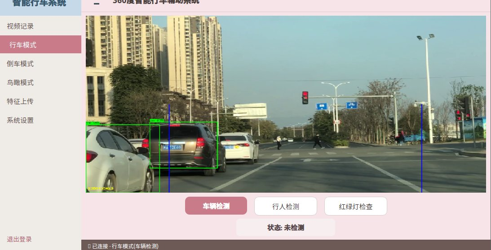
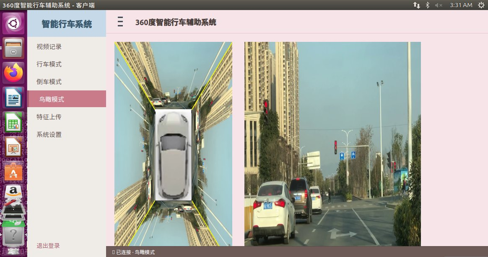

  

## 👨‍💻 关于我

- 🎯 **求职方向**：C/C++ 嵌入式开发 / Qt 桌面应用开发
- 🛠 **日常武器库**：Linux 用户态编程 · 多线程并发 · Socket 网络编程 · FFmpeg 音视频 · 深度模型 C++ 部署
- 📌 习惯把每个项目做出**完整闭环**：协议设计 → 并发架构 → 算法部署 → 界面呈现
- 📮 联系我：**1497062475@qq.com**

## ⚙️ 技术栈

  

---

## 🚀 精选项目

### 🚗 [智能行车辅助系统 · 客户端](https://github.com/xitno1/SmartCarAssist-Client) `团队项目 · 负责客户端`

> 基于 **YOLOv8 + ONNX Runtime + Qt** 的行车辅助客户端 —— 我负责客户端全部代码

<table>
  <tr>
    <td width="50%"></td>
    <td width="50%"></td>
  </tr>
  <tr>
    <td align="center">行车模式 · YOLOv8 实时车辆检测</td>
    <td align="center">360° 鸟瞰环视</td>
  </tr>
</table>

✨ **亮点技术**
- 🧠 ONNX Runtime C++ 部署 **4 个 YOLOv8 模型**（车辆/行人/红绿灯），letterbox 逆映射 + NMS 后处理
- 📡 自研 TCP 应用层协议：**16 字节定长包头 + CRC 校验 + 图片分片传输 + 丢失分片定向重传**
- 🔀 采集 / 网络 / 分片 / 心跳多线程协作，心跳保活

`YOLOv8` `ONNX Runtime` `OpenCV` `TCP` `多线程`

---

### 🌱 [农业大棚环境监控与音视频存储系统](https://github.com/xitno1/SmartSecurityEnvMonitoring) `个人独立开发`

> 基于 **Qt + FFmpeg + SQLite** 的大棚环境监控与音视频存储桌面应用

✨ **亮点技术**
- 🎥 FFmpeg 全链路：摄像头采集 → 解码 → 实时显示，**H.264 编码录像与历史回放**
- 🌡 串口采集温湿/光照数据：Qt Charts 实时曲线 + **阈值告警 + LED/风扇设备联动**
- 🏗 MVC 四层架构（View/Control/Model/Data），采集/编码/播放多线程分离

`Qt` `C++` `FFmpeg` `H.264` `QSerialPort` `SQLite` `Qt Charts`

---

  

